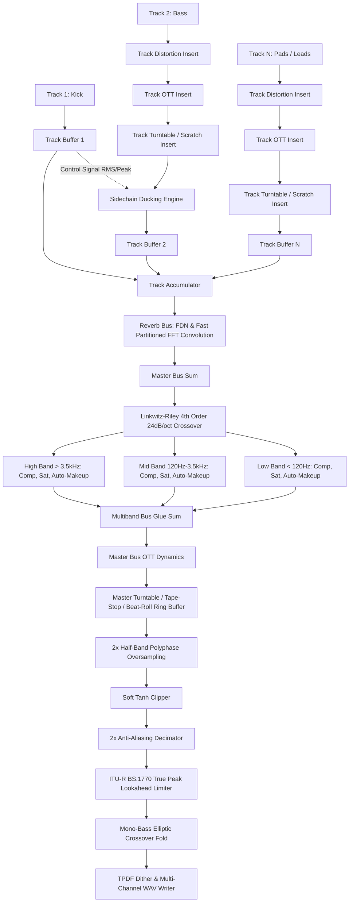

# GUIDE.md — Master Architecture, CLI, Score DSL & DSP Reference

This document is the authoritative, comprehensive master reference manual for **Barbiton**. It is designed specifically for AI models, LLM agents, and audio developers to consume the complete architecture, command-line interface, score schema, synthesizer parameters, SFZ sample playback engine, and DSP specifications in a single read.

---

## Table of Contents

1. [Engine Architecture & Core Philosophy](#1-engine-architecture--core-philosophy)
2. [CLI & Flag Reference](#2-cli--flag-reference)
3. [Score JSON Schema Specification](#3-score-json-schema-specification)
4. [MIDI CC & Controller Automation](#4-midi-cc--controller-automation)
5. [Hybrid Synthesizer Specification](#5-hybrid-synthesizer-specification)
6. [Other Instruments: Ocarina & SFZ Sampler](#6-other-instruments-ocarina--sfz-sampler)
7. [Mixing, Effects & Mastering Processors](#7-mixing-effects--mastering-processors)
8. [Mathematical DSP Formulas & Numerical Robustness](#8-mathematical-dsp-formulas--numerical-robustness)
9. [Composition & Mix Engineering Guidelines for AI Models](#9-composition--mix-engineering-guidelines-for-ai-models)
10. [Ready-to-Copy Master JSON Templates](#10-ready-to-copy-master-json-templates)

---

## 1. Engine Architecture & Core Philosophy

**Barbiton** is an offline orchestral and hybrid synthesizer audio rendering engine written in **pure Go** (`CGO_ENABLED=0`) featuring a **64-bit float DSP core**, a **0-allocation steady-state audio rendering engine**, **hybrid synthesis**, **SFZ sample playback**, **physical modeling**, an **ITU-R BS.1770 True Peak limiter**, **TPDF dither**, an 8-line **FDN reverb**, and **multi-channel audio** output (mono, stereo, 5.1 surround, 7.1 surround). It compiles into a fully static binary (~3.5 MB stripped) for both Linux and Windows with zero dynamic library dependencies.

```text
SCORE INTAKE (JSON DSL or MIDI)
  │ 64 MiB limit reader (`maxScoreFileSize`), strict JSON schema validation
  │ Parse-time stages: transposition, timing offsets, rhythmic swing, metric accents
  ▼
ENGINE SCHEDULING
  │ Sample-accurate on/off events (note-offs dispatched before note-ons on shared frames)
  │ Continuous Automation Curves (Bezier with tension, Exponential, Linear, Step)
  │ Breath shifts (`breath`) per track, staccato release truncation (50% written length)
  │ MIDI CC automation & CC64 sustain pedal dispatch prior to notes
  ▼
PER-TRACK SYNTHESIS & PROCESSING CHAIN
  │ Track Voices: SFZ Sampler (16 poly) | Hybrid Synth (VA/FM/Pluck/Wavetable 16 poly) | Ocarina
  │ Voice Strip: Sample / Oscillator / 2D Wavetable Morphing -> Vibrato LFO -> ADSR Envelopes
  │              -> Velocity x Expression Gain -> Voice Noise Gate -> Voice Distortion
  │ Track Strip: 4-stage Parametric EQ (HPF, Low Shelf, Mid Peak, High Shelf)
  │              -> Studio Analog Distortion Insert (Diode, Tube, HardClip, Foldback with 2x Oversampling)
  │              -> Studio OTT Insert (3-Band Upward/Downward Dynamics)
  │              -> Track Turntable Insert (Brake, Scratch, Beat-Roll, Backspin with Hermite Resampling)
  │              -> Constant-power Pan & Track Volume
  │              -> Independent Track Stereo / Ping-Pong Delay
  │              -> Room Reverb Send Bus
  ▼
MASTER MIX BUS & POOLED REVERB
  │ Sum Dry Audio + Per-Track Delay Returns
  │ Multi-Room Algorithmic FDN Reverb (coprime delay lines, up to 8 pooled rooms)
  │ Master 3-Band Multiband Dynamics Glue Compressor
  │ Master 3-Band OTT Extreme Upward/Downward Compressor
  │ Master Turntable Bus Insert (Master Tape-Stop, Vinyl Scratch, Stutter Roll, Backspin)
  │ Master Saturation: Analog tanh soft clipper (`tape`) or linear clamp (`clean`) with 2x Oversampling
  │ Master Mastering Limiter: ITU-R BS.1770 True Peak 4x oversampling, -0.1 dBFS ceiling
  │ Mono-Bass Crossover Fold: Low-frequency stereo-to-mono collapse
  ▼
WAV ENCODER
  │ PCM 16-bit (with TPDF dither), 24-bit, 32-bit int, 32-bit float (`WAVE_FORMAT_EXTENSIBLE`)
  │ Mono, Stereo, 5.1 Surround (`0x3F`), 7.1 Surround (`0x63F`)
```

### Core Architecture Principles

1. **Zero Heap Allocations in Steady State**:
   - The audio rendering loop performs **0 allocations per block** (`0 B/op`, `0 allocs/op`).
   - All voices, biquad filters, delay ring buffers, LFO state, envelopes, and mixer scratch buffers are pre-allocated during engine construction (`engine.New`).
   - The CLI disables garbage collection pauses during audio processing using `debug.SetGCPercent(-1)`, restoring `debug.SetGCPercent(100)` upon completion.
2. **Deterministic Output Guarantee**:
   - The identical score input rendered multiple times produces **100% bit-identical WAV audio**.
   - All random generators (humanizer timing, sample layer selection, TPDF dither) utilize fixed deterministic seeds.
3. **Concurrency & Worker Panic Isolation**:
   - Sequential rendering runs synchronously on a single goroutine.
   - Parallel rendering (`--parallel`) dispatches per-track voice synthesis across a worker pool sized to `runtime.NumCPU()`.
   - **Byte-Identical Parallelism**: The master mixing summation (`m.sumTrackBus`) processes tracks in fixed, deterministic index order after a synchronization barrier (`sync.WaitGroup`), ensuring bit-identical output to single-threaded renders.
   - **Panic Isolation**: Each worker goroutine runs under `defer recover()`. Panics are trapped, clear the active track buffer to avoid audio stutter, and aggregate into `errors.Join` across all tracks, cleanly terminating execution with exit code 1.
4. **Numerical Robustness & Anti-Denormal Flushing (FTZ)**:
   - Recursive IIR filters (RBJ biquads), FDN delay lines, and delay feedbacks flush decaying values smaller than $10^{-25}$ directly to zero:
     $$\text{if } |y| < 10^{-25} \implies y = 0$$
     This completely eliminates IEEE 754 subnormal (denormal) floating-point calculations, preventing x86 microcode traps and 10–20× CPU slowdowns during silent gaps and decaying reverb tails.
   - Every filter, gain stage, and buffer is sanitized against `NaN` and `±Inf`. Non-finite values are caught and reset to zero without crashing the engine.
5. **Score Intake Guard**:
   - JSON scores are restricted to a maximum file size of 64 MiB (`maxScoreFileSize`).
   - Parsed with `DisallowUnknownFields()` to catch unrecognized or mistyped keys immediately.
   - `score.Validate` aggregates all schema, type, pitch, and timing violations across all tracks and notes into a unified multi-line diagnostic error report.

---

## 2. CLI & Flag Reference

### Synopsis

```bash
barbiton -s <score.json> -o <out.wav> [flags]
```

### Build Instructions

The engine is built from source using standard Go (version 1.22+ or later) with static compilation:

```bash
# Build Linux static binary
CGO_ENABLED=0 go build -ldflags="-s -w" -o ./barbiton ./cmd/barbiton

# Cross-compile Windows static binary from Linux
CGO_ENABLED=0 GOOS=windows GOARCH=amd64 go build -ldflags="-s -w" -o ./barbiton.exe ./cmd/barbiton
```

### Complete Flag Table

| Flag | Short | Type | Allowed Values / Range | Default | Description & Usage |
|------|-------|------|------------------------|---------|---------------------|
| `--score` | `-s` | `string` | File path | `""` | Path to JSON score file (max 64 MiB, auto-validated). Example: `-s score.json` |
| `--output` | `-o` | `string` | File path | `"out.wav"` | Destination path for rendered WAV file. Example: `-o master.wav` |
| `--sample-rate` | — | `int` | `44100`, `48000`, `96000` | `48000` | Output sampling rate in Hz. Example: `--sample-rate=96000` |
| `--bit-depth` | — | `string` | `16`, `24`, `32`, `32f` | `"24"` | WAV bit depth. `16` (PCM + TPDF dither), `24` (PCM), `32` (PCM), `32f` (32-bit float). Example: `--bit-depth=16` |
| `--channels` | — | `int` | `1`, `2`, `6`, `8` | `2` | Audio channels: `1` (mono downmix), `2` (stereo), `6` (5.1 surround), `8` (7.1 surround). Example: `--channels=6` |
| `--mode` | — | `string` | `offline`, `stream` | `"offline"` | Render mode. `offline` writes directly to file; `stream` reserves DAC pipe. Example: `--mode=offline` |
| `--master-gain` | — | `float64` | `0.0..1.0` | `1.0` | Master linear gain scaling multiplier before WAV encoding. Example: `--master-gain=0.9` |
| `--limiter` | — | `bool` | `true`, `false` | `false` | Enables ITU-R BS.1770 True Peak 4x oversampled lookahead limiter (-0.1 dBFS ceiling). Example: `--limiter` |
| `--saturation` | — | `string` | `tape`, `clean` | `"tape"` | Master bus saturation: `tape` uses analog tanh soft clipping; `clean` uses linear clamp at ±1.0. Example: `--saturation=clean` |
| `--reverb` | — | `string` | `cathedral`, `hall`, `chapel`, `room`, `plate`, `none` | `"hall"` | Global master reverb preset space (`none` mutes reverb wet). Example: `--reverb=cathedral` |
| `--reverb-damping`| — | `float64` | `0.0..1.0` or `-1` | `-1` | High-frequency damping absorption. `-1` uses preset default; `0.0` is bright (no HF cutoff); `1.0` is maximum damping. Example: `--reverb-damping=0.0` |
| `--noise-gate` | — | `float64` | `0` or negative dBFS | `0` | Voice noise gate threshold in dBFS (`0` is disabled; e.g. `-60` mutes voices below -60 dBFS). Example: `--noise-gate=-60` |
| `--mono-bass` | — | `string` | `off` or integer Hz | `"off"` | Crossover frequency below which stereo audio is folded to mono. Example: `--mono-bass=120` |
| `--parallel` | — | `bool` | `true`, `false` | `false` | Enables multi-threaded per-track voicing across CPU workers (byte-identical output). Example: `--parallel` |
| `--humanize` | — | `float64` | `0.0..1.0` | `0.0` | Timing and velocity humanization strength using deterministic Gaussian seed. Example: `--humanize=0.5` |
| `--import-midi` | — | `string` | File path | `""` | Import Standard MIDI File (format 0 or 1) and render directly instead of `--score`. Example: `--import-midi=cue.mid` |
| `--export-midi` | — | `string` | File path | `""` | Export loaded score as format-1 Standard MIDI File (480 PPQ) after render. Example: `--export-midi=cue.mid` |
| `--export-json` | — | `string` | File path | `""` | With `--import-midi`: save converted score to JSON. Example: `--export-json=imported.json` |
| `--load-sfz` | — | `string` | File path | `""` | Pre-flight inspect and validate an SFZ library before rendering score. Example: `--load-sfz=test_data/samples/piano.sfz` |
| `--benchmark` | — | `bool` | `true`, `false` | `false` | Renders the score 10 times in memory without disk I/O, prints average duration, then renders to file. Example: `--benchmark` |
| `--batch-dir` | — | `string` | Directory path | `""` | Renders all `.json`, `.mid`, `.midi` files in directory with isolated engines. Example: `--batch-dir=./cues` |
| `--profile-cpu` | — | `string` | File path | `""` | Writes pprof CPU execution profile. Example: `--profile-cpu=cpu.pprof` |
| `--profile-mem` | — | `string` | File path | `""` | Writes pprof heap memory profile after render. Example: `--profile-mem=mem.pprof` |
| `--verbose` | `-v` | `bool` | `true`, `false` | `false` | Diagnostic verbose logging to stderr. Example: `-v` |

### Exit Codes & Console Reporting

- `0`: Execution completed successfully.
- `1`: Parse error, schema validation failure, missing asset, worker panic, or unhandled DSP error.
- All fatal errors output with prefix `barbiton: <error message>` to stderr.
- Rendering progress dynamically streams to stderr: `Rendering:  45.2%`.
- Final render summary prints to stdout:
  ```text
  Rendered 8 tracks -> out.wav (45.20 s, peak 0.892, 1.24s)
  ```

### Spectral Analyzer Tooling

Barbiton includes a standalone Radix-2 Cooley-Tukey FFT spectral analyzer:
```bash
go run ./cmd/analyze_spectrum out.wav
```
Reports file metadata, spectral centroid (Hz), top 8 peak frequency bins (dBFS), energy balance across 7 bands (Sub-Bass, Bass, Low-Mid, Mid, High-Mid, Presence, Brilliance), and reverb tail decay ratio.

---

## 3. Score JSON Schema Specification

Barbiton JSON scores describe a multi-track musical composition. All times and durations are specified in **seconds** (floating point). Pitches are standard **MIDI note numbers** (`60` = Middle C / C4, `69` = A440).

### Evaluation Order

Before audio rendering begins, score transformations execute in strict order:
1. **Transposition**: Metadata `transpose` + Track `transpose` are added to every note's pitch.
2. **Timing Offsets**: `timing_offset_ms` nudges note start times.
3. **Rhythmic Swing**: `swing` delays off-beat eighth notes by $\text{swing} \times \frac{\text{beat}}{3}$.
4. **Metric Accents**: `accent` multipliers scale note velocities (clamped to `1.0`).
5. **Breath Shifts**: Non-zero `phrase_id` transitions insert `breath` millisecond pauses, shifting subsequent notes later in time.
6. **CC Automation & Sustain Pedal**: Sample-accurate CC events and pedal states are queued before notes on shared frames.

---

### Root Object

| Field | Type | Required | Description |
|-------|------|----------|-------------|
| `metadata` | `object` | **Yes** | Score global metadata (tempo, meter, global swing, breath) |
| `tracks` | `array` | **Yes** | Array of track objects. Must contain at least 1 track. |

---

### Metadata Object (`metadata`)

```json
{
  "title": "Symphony No. 5",
  "bpm": 120.0,
  "time_signature": "4/4",
  "transpose": 0,
  "swing": 0.0,
  "breath": 50.0,
  "humanize_timing_ms": 10.0,
  "humanize_velocity": 0.05,
  "convolution_ir": "test_data/samples/reverb/hall.wav",
  "convolution_decay": 1.0,
  "convolution_predelay_ms": 20.0,
  "convolution_dry_wet": 0.25,
  "convolution_low_cut": 40.0,
  "convolution_high_cut": 16000.0,
  "multiband": true,
  "oversampling": true,
  "ott": {
    "depth": 1.0,
    "time_scale": 1.0,
    "in_gain_db": 0.0,
    "out_gain_db": 0.0,
    "band_gains": [0.0, 0.0, 0.0]
  },
  "turntable": {
    "enabled": true,
    "inertia_ms": 30.0,
    "triggers": [
      {
        "time": 2.0,
        "type": "tape_stop",
        "brake_time_ms": 250.0,
        "curve": "exponential"
      }
    ]
  }
}
```

| Field | Type | Default | Allowed Range | Description |
|-------|------|---------|---------------|-------------|
| `title` | `string` | *required* | Non-empty string | Human-readable title of the piece |
| `bpm` | `number` | *required* | `(0, 1000]` | Tempo in beats per minute |
| `time_signature` | `string` | *required* | `"N/D"` format (`N, D > 0`) | Musical meter (e.g., `"4/4"`, `"3/4"`, `"6/8"`) |
| `transpose` | `integer` | `0` | Any integer | Global pitch shift in semitones applied to all tracks |
| `swing` | `number` | `0.0` | `[0.0, 1.0]` | Eighth-note swing intensity (`1.0` = full triplet swing) |
| `breath` | `number` | `0.0` | Finite $\ge 0.0$ ms | Default breath pause between non-zero phrases |
| `humanize_timing_ms` | `number` | `0.0` | Finite $\ge 0.0$ ms | Global micro-jitter applied to note start times ($\pm N\text{ ms}$) |
| `humanize_velocity` | `number` | `0.0` | `[0.0, 1.0]` | Global micro-variation of note hit velocity |
| `convolution_ir` | `string` | `""` | File path | Path to 16/24/32-bit mono/stereo WAV impulse response file |
| `convolution_decay` | `number` | `1.0` | `[0.05, 10.0]` | Convolution reverb tail length decay multiplier |
| `convolution_predelay_ms` | `number` | `0.0` | `[0.0, 500.0]` ms | Pre-delay before convolution wet signal onset |
| `convolution_dry_wet` | `number` | `0.3` | `[0.0, 1.0]` | Master convolution reverb wet/dry mix balance |
| `convolution_low_cut` | `number` | `20.0` | `[10.0, 20000.0]` Hz | High-pass filter cutoff on wet convolution reverb |
| `convolution_high_cut` | `number` | `18000.0` | `[100.0, 22000.0]` Hz | Low-pass filter cutoff on wet convolution reverb |
| `multiband` | `boolean` | `false` | `true`, `false` | Enables 3-band Linkwitz-Riley crossover bus glue compressor |
| `oversampling` | `boolean` | `false` | `true`, `false` | Enables 2x half-band polyphase FIR oversampling for saturation |
| `ott` | `object` or `boolean` | *absent* | Object or `true` | Master 3-band upward/downward OTT extreme dynamics processor |
| `turntable` | `object` or `boolean` | *absent* | Object or `true` | Master DJ turntable processor (`enabled`, `inertia_ms`, `triggers`) |
| `turntable_triggers` | `array` | `[]` | Array of trigger objects | Direct root-level trigger events for master turntable |

---

### Track Object (`tracks[...]`)

```json
{
  "id": "violins_1",
  "name": "First Violins",
  "instrument": {
    "type": "synth",
    "parameters": {
      "synth_mode": 0,
      "waveform1": 0,
      "cutoff": 3500.0,
      "velocity_to_filter": 0.5,
      "velocity_to_attack": 0.4
    }
  },
  "volume": 0.85,
  "pan": -0.3,
  "transpose": 0,
  "swing": 0.0,
  "expression": 1.0,
  "breath": 0.0,
  "humanize_timing_ms": 8.0,
  "humanize_velocity": 0.04,
  "sidechain_source": "kick",
  "sidechain_ducking_db": -20.0,
  "sidechain_attack_ms": 10.0,
  "sidechain_release_ms": 100.0,
  "sidechain_hold_ms": 10.0,
  "sidechain_ratio": 4.0,
  "sidechain_makeup_db": 0.0,
  "room": "cathedral",
  "reverb_send": 0.35,
  "eq": {
    "hpf": 80.0,
    "eq_low": {"freq": 250.0, "gain": -2.0, "q": 1.0},
    "eq_mid": {"freq": 1500.0, "gain": 1.5, "q": 2.0},
    "eq_high": {"freq": 8000.0, "gain": 2.0, "q": 0.707}
  },
  "delay": {
    "mode": "pingpong",
    "subdivision": "1/8d",
    "seconds": 0.0,
    "feedback": 0.35,
    "damping_hz": 3000.0,
    "wet": 0.25
  },
  "distortion": {
    "mode": "tube",
    "drive": 2.5,
    "tone": 1.0,
    "mix": 0.7,
    "output_gain_db": 0.0
  },
  "ott": {
    "depth": 0.8,
    "time_scale": 1.0,
    "in_gain_db": 0.0,
    "out_gain_db": 0.0,
    "band_gains": [0.0, 0.0, 0.0]
  },
  "turntable": {
    "enabled": true,
    "inertia_ms": 25.0
  },
  "turntable_triggers": [
    {"time": 1.0, "type": "beat_roll", "subdivision": "1/16"}
  ],
  "automation": {
    "cutoff": [
      {"time": 0.0, "value": 200.0},
      {"time": 1.5, "value": 4500.0, "curve": "bezier", "tension": 0.5}
    ],
    "fm_depth": [
      {"time": 1.0, "value": 0.0},
      {"time": 1.25, "value": 8.0, "curve": "exponential"}
    ],
    "lfo_rate": [
      {"time": 2.0, "value": 2.0},
      {"time": 2.5, "value": 16.0, "curve": "linear"}
    ],
    "pitch_bend": [
      {"time": 0.0, "value": 0.0},
      {"time": 0.2, "value": -12.0}
    ],
    "distortion_drive": [
      {"time": 0.0, "value": 1.0},
      {"time": 1.0, "value": 8.0, "curve": "linear"}
    ]
  },
  "pedal": [
    {"time": 0.0, "down": true},
    {"time": 4.0, "down": false}
  ],
  "cc": [
    {"time": 0.0, "controller": 11, "value": 100},
    {"time": 2.0, "controller": 74, "value": 120}
  ],
  "notes": [
    {"time": 0.0, "duration": 2.0, "pitch": 60, "velocity": 0.8}
  ]
}
```

| Field | Type | Default | Allowed Range | Description |
|-------|------|---------|---------------|-------------|
| `id` | `string` | *required* | Non-empty, unique | Unique identifier for track within score |
| `name` | `string` | `""` | Any string | Descriptive display label |
| `instrument` | `object` | *required* | Object | Sound generator definition (`type`, `file`, `parameters`) |
| `volume` | `number` | *required* | `[0.0, 1.0]` | Track master linear gain multiplier |
| `pan` | `number` | `0.0` | `[-1.0, 1.0]` | Stereo placement (`-1.0` hard left, `0.0` center, `1.0` hard right) |
| `transpose` | `integer` | `0` | Any integer | Per-track semitone pitch shift (added to global transpose) |
| `swing` | `number` | `0.0` | `[0.0, 1.0]` | Track-level swing override (if $> 0$, overrides metadata swing) |
| `vibrato` | `object` | *absent* | `{"rate": float, "depth": float}` | Per-track pitch vibrato LFO default inherited by notes |
| `expression` | `number` | `1.0` | `[0.0, 1.0]` | Track-level dynamic expression multiplier |
| `breath` | `number` | `0.0` | Finite $\ge 0.0$ ms | Track-level phrase pause (if $> 0$, overrides metadata breath) |
| `humanize_timing_ms` | `number` | `0.0` | Finite $\ge 0.0$ ms | Per-track timing jitter override (if $> 0$, overrides metadata) |
| `humanize_velocity` | `number` | `0.0` | `[0.0, 1.0]` | Per-track velocity variation override (if $> 0$, overrides metadata) |
| `sidechain_source` | `string` | `""` | Track ID | ID of control track triggering sidechain ducking (e.g. `"kick"`) |
| `sidechain_ducking_db`| `number` | `-20.0` | Any finite dB | Sidechain compression threshold in dB |
| `sidechain_attack_ms` | `number` | `10.0` | Finite $\ge 0.0$ ms | Sidechain ducking attack smoothing time in ms |
| `sidechain_release_ms`| `number` | `100.0` | Finite $\ge 0.0$ ms | Sidechain ducking release recovery time in ms |
| `sidechain_hold_ms`   | `number` | `10.0` | Finite $\ge 0.0$ ms | Sidechain ducking hold time before release commences |
| `sidechain_ratio`     | `number` | `4.0` | $\ge 1.0$ | Sidechain compression ratio |
| `sidechain_makeup_db` | `number` | `0.0` | Any finite dB | Post-ducking makeup gain in dB |
| `room` | `string` or `object` | *absent* | Preset name or custom | Track acoustic space (`cathedral`, `hall`, `chapel`, `room`, `plate`, `none`) or custom `{"size": 0..1, "damping": 0..1, "width": 0..1}` |
| `reverb_send` | `number` | `0.0` | `[0.0, 1.0]` | Linear send level into track's room reverb bus |
| `eq` | `object` | *absent* | Object | Parametric 4-stage EQ sculpt applied before sends |
| `delay` | `object` | *absent* | Object | Independent per-track stereo / ping-pong echo unit |
| `distortion` | `object` or `string` | *absent* | Object or preset name | Studio analog distortion insert (`diode`, `tube`, `hardclip`, `foldback` with 2x oversampling) |
| `ott` | `object` or `boolean` | *absent* | Object or `true` | Studio 3-band upward/downward dynamics insert (`depth`, `time_scale`, `in_gain_db`, `out_gain_db`, `band_gains`) |
| `turntable` | `object` or `boolean` | *absent* | Object or `true` | Track DJ turntable processor (`enabled`, `inertia_ms`, `triggers`) |
| `turntable_triggers` | `array` | `[]` | Array of trigger objects | Direct trigger events scheduled on this track's turntable |
| `automation` | `object` | *absent* | Map of parameter names to point arrays | Continuous automation curves with Bezier, Exponential, Linear, Step |
| `pedal` | `array` | `[]` | Array of objects | Sustain pedal (CC64) moves (`time`, `down`) |
| `cc` | `array` | `[]` | Array of objects | MIDI Continuous Controller automation events |
| `notes` | `array` | `[]` | Array of objects | Array of note events scheduled on this track |

---

### Continuous Parameter Automation Curves (`automation`)

Barbiton provides native continuous curve parameter automation for tracks and instruments, eliminating stepped artifacts and click/zipper noise through real-time sub-block interpolation ($\le 64$ frames / $1.33\text{ ms}$ at 48 kHz) with **zero heap allocations**:

```json
{
  "automation": {
    "cutoff": [
      {"time": 0.0, "value": 200.0},
      {"time": 1.5, "value": 4500.0, "curve": "bezier", "tension": 0.5}
    ],
    "fm_depth": [
      {"time": 1.0, "value": 0.0},
      {"time": 1.25, "value": 8.0, "curve": "exponential"}
    ],
    "lfo_rate": [
      {"time": 2.0, "value": 2.0},
      {"time": 2.5, "value": 16.0, "curve": "linear"}
    ],
    "pitch_bend": [
      {"time": 0.0, "value": 0.0},
      {"time": 0.2, "value": -12.0}
    ],
    "distortion_drive": [
      {"time": 0.0, "value": 1.0},
      {"time": 1.0, "value": 8.0, "curve": "linear"}
    ]
  }
}
```

#### Supported Interpolation Curves

For normalized segment progress $u = \frac{t - t_0}{t_1 - t_0} \in [0, 1]$ between point $P_0 = (t_0, v_0)$ and $P_1 = (t_1, v_1)$:

1. **Linear** (`"curve": "linear"`, default):
   $$v(u) = v_0 + u \cdot (v_1 - v_0)$$
2. **Bezier with Tension** (`"curve": "bezier"`, `"tension": [-1.0, 1.0]`):
   Controls transition curve steepness and curvature via tension parameter $\tau \in [-1.0, 1.0]$:
   $$P_1 = 0.5 \cdot (1.0 - \tau), \quad P_2 = 0.5 \cdot (1.0 + \tau)$$
   $$B(u) = 3(1-u)^2 u P_1 + 3(1-u) u^2 P_2 + u^3$$
   $$v(u) = v_0 + B(u) \cdot (v_1 - v_0)$$
   When $\tau = 0.5$, generates smooth natural ease-in-out S-curves.
3. **Exponential** (`"curve": "exponential"` or `"exp"`):
   For strictly positive frequency values ($v_0, v_1 > 0$):
   $$v(u) = v_0 \cdot \left(\frac{v_1}{v_0}\right)^u = v_0 \cdot e^{u \ln(v_1 / v_0)}$$
   For ranges spanning zero ($v_0 \le 0$ or $v_1 \le 0$):
   $$w(u) = \frac{e^{2.5 u} - 1}{e^{2.5} - 1}, \quad v(u) = v_0 + w(u) \cdot (v_1 - v_0)$$
4. **Step** (`"curve": "step"` or `"hold"`):
   Holds initial value $v_0$ until arrival at $t_1$, then instantly switches to $v_1$.

#### Automatable Parameters

| Target Parameter | Target Unit / Domain | Description |
|------------------|----------------------|-------------|
| `cutoff` | `[20.0, 20000.0]` Hz | Lowpass filter cutoff frequency |
| `resonance` | `[0.0, 1.0]` | Filter resonance peak sharpness |
| `volume` | `[0.0, 1.0]` | Track linear output gain |
| `pan` | `[-1.0, 1.0]` | Track stereo field placement |
| `pitch_bend` | Semitones (e.g. `[-24.0, 24.0]`) | Real-time continuous voice pitch bend |
| `wavetable_pos` | `[0.0, 1.0]` | 2D Wavetable frame morph scanning position |
| `fm_depth` | `[0.0, 16.0]` | FM synthesis modulation index |
| `fm_ratio` | `[0.1, 32.0]` | FM carrier-to-modulator harmonic ratio |
| `lfo_rate` | `[0.01, 50.0]` Hz | Modulation LFO speed |
| `distortion_drive` | `[0.1, 50.0]` | Track or synth distortion saturation gain |
| `distortion_mix` | `[0.0, 1.0]` | Distortion dry/wet mix |
| `ott_depth` | `[0.0, 1.0]` | OTT multiband compressor wetness |
| `reverb_send` | `[0.0, 1.0]` | Reverb send bus injection level |
| `turntable_speed` / `scratch_speed` | `[-3.0, 3.0]` | Vinyl scratching relative speed ($v < 0$ reverse, $v > 0$ forward) |
| `turntable_brake` / `tape_stop` | Seconds $> 0$ | Turntable brake / tape stop trigger duration in seconds |
| `beat_roll` / `stutter` | Subdivision code | Stutter freeze loop (`0`=off, `4`=1/4, `8`=1/8, `16`=1/16, `32`=1/32) |
| `backspin` | `[-3.0, -1.0]` | Reverse backspin trigger speed with exponential spin-down |

---

### Note Event Object (`notes[...]`)

```json
{
  "time": 0.0,
  "duration": 2.0,
  "pitch": 60,
  "velocity": 0.8,
  "timing_offset_ms": 2.5,
  "accent": 1.1,
  "attack": 0.01,
  "decay": 0.1,
  "release": 0.3,
  "phrase_id": 1,
  "vibrato": {"rate": 5.5, "depth": 0.03},
  "expression": 0.9,
  "articulation": {"type": "legato"}
}
```

| Field | Type | Default | Allowed Range | Description |
|-------|------|---------|---------------|-------------|
| `time` | `number` | *required* | Finite $\ge 0.0$ s | Start timestamp in seconds from piece beginning |
| `duration` | `number` | *required* | Finite $> 0.0$ s | Written length in seconds. Staccato releases at $0.5 \times \text{duration}$. |
| `pitch` | `integer` | *required* | `0..127` | MIDI pitch number ($60 = \text{C4}$). Must remain in `[0, 127]` after transposition. |
| `velocity` | `number` | *required* | `[0.0, 1.0]` | Note strike intensity / volume scaling |
| `timing_offset_ms`| `number` | `0.0` | Any finite float | Intentional timing nudge in milliseconds (positive = delayed) |
| `accent` | `number` | `1.0` | Multiplier | Velocity scaling factor (velocity $\times$ accent, clamped to 1.0) |
| `attack` | `number` | *instrument*| Seconds $\ge 0.0$ | Per-note envelope attack time override |
| `decay` | `number` | *instrument*| Seconds $\ge 0.0$ | Per-note envelope decay time override |
| `release` | `number` | *instrument*| Seconds $\ge 0.0$ | Per-note envelope release time override |
| `phrase_id` | `integer` | `0` | Integer $\ge 0$ | Phrase grouping index; transition between different non-zero IDs triggers breath pause |
| `vibrato` | `object` | *track/none*| `{"rate": float, "depth": float}` | Per-note pitch LFO override |
| `expression` | `number` | *track* | `[0.0, 1.0]` | Per-note dynamic expression gain override |
| `articulation` | `object` | *absent* | `{"type": "staccato"\|"legato"\|"tenuto"}` | Articulation style (`staccato` halves duration) |

---

### Parametric EQ Object (`eq`)

Each track features a dedicated 4-stage parametric equalizer evaluated in-place before delay/reverb sends:
1. **High-Pass Filter (`hpf`)**: 2-pole Butterworth high-pass (`0` = bypassed, `> 0` sets cutoff frequency up to 100 kHz).
2. **Low Shelf (`eq_low`)**: Shelving filter for low frequencies.
3. **Mid Peak (`eq_mid`)**: Peaking parametric filter with adjustable Q.
4. **High Shelf (`eq_high`)**: Shelving filter for high frequencies.

Band schema:
```json
{
  "eq": {
    "hpf": 80.0,
    "eq_low":  {"freq": 200.0, "gain": -2.0, "q": 0.707},
    "eq_mid":  {"freq": 1000.0, "gain": 1.5, "q": 2.0},
    "eq_high": {"freq": 6000.0, "gain": 2.5, "q": 0.707}
  }
}
```

| Field | Range | Description |
|-------|-------|-------------|
| `freq` | `(0.0, 100000.0)` Hz | Center or corner frequency |
| `gain` | `[-36.0, 36.0]` dB | Boost or cut amount |
| `q` | `[0.0, 50.0]` | Quality factor (`0` selects internal band default: 0.707 for shelves, 1.0 for mid) |

---

### Delay Object (`delay`)

Every track containing a `delay` block instantiates an independent stereo echo unit:
```json
{
  "delay": {
    "mode": "pingpong",
    "subdivision": "1/8d",
    "seconds": 0.0,
    "feedback": 0.4,
    "damping_hz": 3500.0,
    "wet": 0.3
  }
}
```

| Field | Type | Default | Range / Values | Description |
|-------|------|---------|----------------|-------------|
| `mode` | `string` | `"stereo"` | `"stereo"`, `"pingpong"` (or `"ping-pong"`, `"ping_pong"`) | Echo routing topology |
| `subdivision`| `string`| `"1/4"` | `"1/1"`, `"1/2"`, `"1/4"`, `"1/8"`, `"1/8d"`, `"1/16"`, `"1/16t"` | BPM-synced delay length (`1/8d` = dotted eighth, `1/16t` = sixteenth triplet) |
| `seconds` | `number` | `0.0` | `[0.0, 4.0]` | Exact delay time in seconds (if $> 0$, overrides `subdivision`) |
| `feedback` | `number` | `0.0` | `[0.0, 0.98]` | Regeneration loop gain |
| `damping_hz`| `number`| `4000.0`| `[0.0, 100000.0)` | 1-pole lowpass filter in feedback loop (`0` selects 4000 Hz) |
| `wet` | `number` | `0.0` | `[0.0, 1.0]` | Delay return mix level (`0.0` = completely dry) |

---

## 4. MIDI CC & Controller Automation

Track-level automation events are declared in the `cc` array:
```json
{
  "cc": [
    {"time": 0.0, "controller": 11, "value": 80},
    {"time": 1.5, "controller": 74, "value": 110},
    {"time": 3.0, "cc": 1, "value": 64}
  ]
}
```
*(Both `"controller"` and `"cc"` keys are accepted).*

### Dispatch Semantics

- CC events are sorted and evaluated on the exact frame matching `time`.
- On shared frames, CC events are dispatched **before note-ons**, guaranteeing filter, expression, and pedal parameters are armed before the audio voice is triggered.
- Controller values range from `0` to `127`.

### CC Controller Mappings

| CC # | Name | Destination in Engine | Scaling Formula | Effect |
|------|------|-----------------------|-----------------|--------|
| **1** | Modulation Wheel | Pitch Vibrato / LFO Depth | Synth: $\text{val} / 127 \times 2.0$<br>Ocarina: $\text{val} / 127 \times 0.1$ | Modulates pitch vibrato LFO depth in semitones |
| **11**| Expression | Dynamic Volume & Voice Expression | Linear gain: $\text{Volume} \times (\text{val} / 127)$ | Smooth dynamic volume swell independent of note velocity |
| **64**| Sustain Pedal | Voice Hold / Damper State | $\text{val} \ge 64 \implies \text{true}$<br>$\text{val} < 64 \implies \text{false}$ | Holds notes past written note-off until pedal release |
| **71**| Resonance | Filter Resonance Peak | $\text{val} / 127.0 \in [0.0, 1.0]$ | Dynamically increases filter resonant peak emphasis |
| **74**| Brightness / Cutoff | Filter Cutoff / Pluck Brightness | Synth Mode 0: $20 + (\text{val}/127) \times 19980$ Hz<br>Synth Mode 2: $200 + (\text{val}/127) \times 19800$ Hz<br>Ocarina: $\text{val} / 127.0 \in [0.0, 1.0]$ | Dynamically opens or closes filter cutoff frequency |

### Sustain Pedal Block (`pedal`)

As an alternative or companion to `cc` controller 64, the declarative `pedal` array manages damper pedal state:
```json
{
  "pedal": [
    {"time": 0.0, "down": true},
    {"time": 3.8, "down": false}
  ]
}
```
When `down: true` is active, note-off events do not release sampler or synth voices; the voice remains in sustain state. When `down: false` triggers, all voices with deferred releases enter their envelope release phase simultaneously.

---

## 5. Hybrid Synthesizer Specification

The hybrid synthesizer (`type: "synth"`) is a 16-voice polyphonic multi-engine synthesizer requiring **no external sample files**. It supports four distinct synthesis engines selected via `synth_mode` (or alias `mode`):
- **Mode 0**: Virtual Analog & Subtractive Synthesis
- **Mode 1**: 2-Operator Phase Modulation / FM Synthesis
- **Mode 2**: Karplus-Strong Physical Modeling Pluck
- **Mode 3**: Wavetable 2D Morphing Engine

### Mode 0: Virtual Analog & Subtractive Synthesis (`synth_mode: 0`)

```json
{
  "instrument": {
    "type": "synth",
    "parameters": {
      "synth_mode": 0,
      "waveform1": 0,
      "waveform2": 1,
      "pulse_width": 0.45,
      "detune": 0.15,
      "filter_type": 2,
      "cutoff": 2500.0,
      "resonance": 0.35,
      "filter_attack": 0.02,
      "filter_decay": 0.3,
      "filter_sustain": 0.4,
      "filter_release": 0.5,
      "filter_env_depth": 3.0,
      "unison_voices": 3,
      "unison_detune": 0.2,
      "unison_spread": 0.7,
      "lfo_waveform": 0,
      "lfo_rate": 4.5,
      "lfo_delay": 0.2,
      "lfo_pitch_depth": 0.1,
      "lfo_filter_depth": 1.5,
      "lfo_amp_depth": 0.0,
      "attack": 0.01,
      "decay": 0.2,
      "sustain": 0.7,
      "release": 0.4,
      "portamento": 0.05
    }
  }
}
```

#### Mode 0 Parameters Table

| Parameter | Allowed Range / Values | Default | Description |
|-----------|------------------------|---------|-------------|
| `synth_mode` (or `mode`) | `0` | `0` | Virtual Analog & Subtractive synthesis engine |
| `waveform1` | `0..5` | `0` | Oscillator 1: `0`=Saw, `1`=Square/Pulse, `2`=Sine, `3`=Triangle, `4`=White Noise, `5`=Pink Noise |
| `waveform2` | `0..5` | `0` | Oscillator 2: `0`=Saw, `1`=Square/Pulse, `2`=Sine, `3`=Triangle, `4`=White Noise, `5`=Pink Noise |
| `pulse_width` | `[0.05, 0.95]` | `0.5` | Pulse duty cycle (aliases: `pwm`, `pw`, `pulse_width1`, `pulse_width2`) |
| `detune` | `[-12.0, 12.0]` semitones | `0.0` | Frequency offset of Oscillator 2 relative to Oscillator 1 |
| `filter_type` | `0..3` | `0` | Filter topology: `0`=1-pole 6dB RC, `1`=12dB SVF, `2`=24dB Cascade SVF, `3`=24dB Ladder |
| `cutoff` | `[20.0, 20000.0]` Hz | `4000.0` | Lowpass filter cutoff corner frequency |
| `resonance` | `[0.0, 1.0]` | `0.2` | Resonance peak intensity (maps internally up to 0.8 max Q) |
| `filter_attack` | `[0.0005, 10.0]` s | `0.005` | Filter ADSR envelope attack time |
| `filter_decay` | `[0.001, 10.0]` s | `0.1` | Filter ADSR envelope decay time |
| `filter_sustain` | `[0.0, 1.0]` | `0.8` | Filter ADSR envelope sustain level |
| `filter_release` | `[0.005, 10.0]` s | `0.2` | Filter ADSR envelope release time |
| `filter_env_depth` | `[-10.0, 10.0]` octaves | `0.0` | Bipolar envelope-to-cutoff modulation depth |
| `pan_spread` | `[0.0, 1.0]` | `0.0` | Voice allocation stereo pan width spread |
| `unison_voices` | `1..7` | `1` | Polyphonic unison voice stacking count |
| `unison_detune` | `[0.0, 1.0]` | `0.0` | Frequency detune spread among unison voices |
| `unison_spread` | `[0.0, 1.0]` | `0.0` | Stereo panning spread among unison voices |
| `lfo_waveform` | `0..4` | `0` | LFO waveform: `0`=Sine, `1`=Triangle, `2`=Saw, `3`=Square, `4`=S&H |
| `lfo_rate` | `[0.01, 50.0]` Hz | `5.0` | LFO modulation frequency |
| `lfo_delay` | `[0.0, 2.0]` s | `0.0` | Delay onset before LFO modulation ramps up |
| `lfo_pitch_depth` | `[-24.0, 24.0]` semitones | `0.0` | Pitch modulation depth (vibrato) |
| `lfo_filter_depth` | `[-10.0, 10.0]` octaves | `0.0` | Cutoff modulation depth (filter wah/sweep) |
| `lfo_amp_depth` | `[0.0, 1.0]` | `0.0` | Amplitude modulation depth (tremolo) |
| `attack` | `[0.0005, 2.0]` s | `0.005` | Amplifier ADSR envelope attack time |
| `decay` | `[0.001, 2.0]` s | `0.1` | Amplifier ADSR envelope decay time |
| `sustain` | `[0.0, 1.0]` | `0.8` | Amplifier ADSR envelope sustain level |
| `release` | `[0.005, 10.0]` s | `0.2` | Amplifier ADSR envelope release time |
| `velocity_to_filter` | `[0.0, 1.0]` | `0.0` | Velocity-to-cutoff opening dynamic modulation (up to 4 octaves) |
| `velocity_to_attack` | `[0.0, 1.0]` | `0.0` | Velocity-to-attack slope dynamic modulation (shorter attack at higher hit strength) |
| `portamento` (or `glide`) | `[0.0, 5.0]` s | `0.0` | Pitch glide duration between consecutive notes |

#### Dual Oscillators & Waveforms
- `waveform1`, `waveform2`:
  - `0` = **Sawtooth**: PolyBLEP anti-aliased band-limited ramp.
  - `1` = **Square / Pulse**: PolyBLEP anti-aliased pulse with variable duty cycle.
  - `2` = **Sine**: Pure polynomial approximation oscillator.
  - `3` = **Triangle**: PolyBLAMP anti-aliased integrated square.
  - `4` = **White Noise**: High-entropy uniform PRNG noise.
  - `5` = **Pink Noise**: Paul Kellet 3-pole $-3\text{ dB/oct}$ filtered noise.
- `pulse_width` (aliases: `pwm`, `pw`, `pulse_width1`, `pulse_width2`): Duty cycle in `[0.05, 0.95]` (default `0.5`).
- `detune`: Frequency offset of Oscillator 2 relative to Oscillator 1 in semitones (`[-12.0, 12.0]`, default `0.0`).

#### Filter Types & Topologies (`filter_type`)
- `0` = **1-Pole RC Lowpass**: Gentle $6\text{ dB/octave}$ slope.
- `1` = **12 dB SVF**: 2-pole State-Variable Filter ($12\text{ dB/octave}$) with Butterworth resonance.
- `2` = **24 dB Cascade**: 4-pole cascaded dual SVF ($24\text{ dB/octave}$) for steep modern subtractive filtering.
- `3` = **24 dB Ladder**: Moog-style 4-pole cascaded non-linear ladder lowpass with feedback resonance saturation.
- `cutoff`: Filter cutoff frequency in `[20.0, 20000.0]` Hz (default `4000.0`).
- `resonance`: Resonance peak intensity in `[0.0, 1.0]` (default `0.2`, internally mapped up to $0.8$ max Q).

#### Filter Envelope (ADSR)
- `filter_attack`: Attack time in `[0.0005, 10.0]` s (default `0.005`).
- `filter_decay`: Decay time in `[0.001, 10.0]` s (default `0.1`).
- `filter_sustain`: Sustain level in `[0.0, 1.0]` (default `0.8`).
- `filter_release`: Release time in `[0.005, 10.0]` s (default `0.2`).
- `filter_env_depth`: Bipolar modulation depth in `[-10.0, 10.0]` octaves (default `0.0`).

#### Unison & Stereo Widening
- `unison_voices`: Voice count per note in `[1, 7]` (default `1`). Odd numbers place one voice center.
- `unison_detune`: Detuning intensity across unison voices in `[0.0, 1.0]` (default `0.0`).
- `unison_spread`: Stereo panning distribution width in `[0.0, 1.0]` (default `0.0`).
- `pan_spread`: Voice allocation panning spread across stereo field in `[0.0, 1.0]` (default `0.0`).

#### Modulation LFO
- `lfo_waveform`:
  - `0` = Sine
  - `1` = Triangle
  - `2` = Sawtooth
  - `3` = Square
  - `4` = Sample & Hold (stepped pseudo-random voltage)
- `lfo_rate`: LFO frequency in `[0.01, 50.0]` Hz (default `5.0`).
- `lfo_delay`: Pre-modulation onset delay in `[0.0, 2.0]` s (default `0.0`).
- `lfo_pitch_depth`: Pitch modulation depth in `[-24.0, 24.0]` semitones (vibrato).
- `lfo_filter_depth`: Filter cutoff modulation depth in `[-10.0, 10.0]` octaves (wah/sweep).
- `lfo_amp_depth`: Amplitude modulation depth in `[0.0, 1.0]` (tremolo).

#### Amplifier ADSR Envelope & Performance
- `attack`: Amplifier attack in `[0.0005, 2.0]` s (default `0.005`).
- `decay`: Amplifier decay in `[0.001, 2.0]` s (default `0.1`).
- `sustain`: Amplifier sustain level in `[0.0, 1.0]` (default `0.8`).
- `release`: Amplifier release in `[0.005, 10.0]` s (default `0.2`).
- `portamento` (alias: `glide`): Pitch glide time between consecutive notes in `[0.0, 5.0]` s (default `0.0`).

---

### Mode 1: FM Synthesis (`synth_mode: 1`)

A phase modulation engine with carrier and modulator oscillators:
$$\text{Carrier Phase} = \phi_c + I(t) \cdot \sin(\phi_m + \beta \cdot y_{\text{prev}})$$

```json
{
  "instrument": {
    "type": "synth",
    "parameters": {
      "synth_mode": 1,
      "fm_ratio": 2.0,
      "fm_depth": 3.5,
      "fm_feedback": 0.25,
      "fm_attack": 0.005,
      "fm_decay": 0.4,
      "fm_sustain": 0.2,
      "fm_release": 0.3
    }
  }
}
```

| Parameter | Allowed Range | Default | Description |
|-----------|---------------|---------|-------------|
| `fm_ratio` | `[0.1, 32.0]` | `1.0` | Modulator frequency multiplier relative to carrier frequency |
| `fm_depth` (or `fm_index`)| `[0.0, 16.0]` | `0.0` | Peak modulation index / FM depth |
| `fm_feedback` | `[0.0, 1.0]` | `0.0` | Modulator self-modulation feedback intensity |
| `fm_attack` | `[0.0005, 10.0]` s | `0.005` | Modulator modulation index envelope attack time |
| `fm_decay` | `[0.001, 10.0]` s | `0.1` | Modulator modulation index envelope decay time |
| `fm_sustain`| `[0.0, 1.0]` | `0.8` | Modulator sustain level multiplier |
| `fm_release`| `[0.005, 10.0]` s | `0.2` | Modulator envelope release time |

---

### Mode 2: Karplus-Strong Physical Modeling Pluck (`synth_mode: 2`)

Simulates vibrating strings, acoustic harps, acoustic guitars, and pizzicato plucks using an excitation burst fed into a fractional delay ring buffer:

```json
{
  "instrument": {
    "type": "synth",
    "parameters": {
      "synth_mode": 2,
      "pluck_damping": 0.3,
      "pluck_decay": 0.985,
      "pluck_brightness": 8000.0,
      "pluck_pick_position": 0.22
    }
  }
}
```

| Parameter | Allowed Range | Default | Description |
|-----------|---------------|---------|-------------|
| `pluck_damping` (or `pluck_damp`) | `[0.0, 1.0]` | `0.5` | Feedback loop high-frequency loss filter ($0.0$ = bright ring, $1.0$ = muted thud) |
| `pluck_decay` | `[0.8, 0.9999]` | `0.98` | Feedback loop sustain multiplier ($0.999$ = long ringing tail) |
| `pluck_brightness` | `[200.0, 20000.0]` Hz | `10000.0` | Initial white noise burst excitation lowpass filter cutoff |
| `pluck_pick_position` (or `pluck_pick_pos`) | `[0.0, 1.0]` | `0.2` | Comb pick filter location ($0.5$ = center strike cancels even harmonics) |

---

### Mode 3: Wavetable 2D Morphing Engine (`synth_mode: 3`)

Scans band-limited 2D wavetable arrays containing 16 frames of 2048 samples each, offering smooth spectral morphing from classic waveforms to complex vocal formants and modern aggressive textures:

```json
{
  "instrument": {
    "type": "synth",
    "parameters": {
      "synth_mode": 3,
      "table_name": "aggressive_modern",
      "wavetable_pos": 0.25,
      "wavetable_env_depth": 0.5,
      "wavetable_lfo_depth": 0.1,
      "cutoff": 3500.0,
      "resonance": 0.3,
      "distortion_mode": "tube",
      "distortion_drive": 2.5
    }
  }
}
```

#### Built-in Reference Wavetables
- `"saw_to_square"`: Smooth harmonic transition from an analog sawtooth spectrum (frame 0) to a hollow odd-harmonic square spectrum (frame 15).
- `"metallic_growl"`: Inharmonic upper partials with steep resonant notches for modern bass design and heavy leads.
- `"vocal_formant_talk"`: Multi-peak vocal tract spectral resonances creating vowel transitions ("aa-ee-oo-ah").
- `"aggressive_modern"`: Folded waveforms with intense harmonic bite, transient edge, and bright modern presence.

#### Hermite Bicubic Interpolation
To eliminate aliasing, zipper noise, and discontinuity clicks, the engine uses 4-point cubic Hermite interpolation along the time phase axis:
$$h(t, y_0, y_1, y_2, y_3) = y_1 + 0.5 \cdot t \cdot (y_2 - y_0 + t \cdot (2 y_0 - 5 y_1 + 4 y_2 - y_3 + t \cdot (3(y_1 - y_2) + y_3 - y_0)))$$
Between adjacent frames, the engine continuously morphs samples proportionally based on `wavetable_pos` $\in [0.0, 1.0]$.

| Parameter | Allowed Range | Default | Description |
|-----------|---------------|---------|-------------|
| `table_name` | `"saw_to_square"`, `"metallic_growl"`, `"vocal_formant_talk"`, `"aggressive_modern"` | `"saw_to_square"` | Pre-computed bandlimited 2D wavetable asset |
| `wavetable_pos` | `[0.0, 1.0]` | `0.0` | Initial frame position index along the wavetable |
| `wavetable_env_depth` | `[-1.0, 1.0]` | `0.0` | Modulates wavetable position via dedicated envelope |
| `wavetable_lfo_depth` | `[-1.0, 1.0]` | `0.0` | Modulates wavetable position via LFO |
| `pitch_bend` | `[-24.0, 24.0]` semitones | `0.0` | Pitch bend offset in semitones |
| `distortion_mode` | `"diode"`, `"tube"`, `"hardclip"`, `"foldback"` | `""` | Optional per-voice waveshaper saturation mode |
| `distortion_drive` | `[0.0, 10.0]` | `0.0` | Pre-gain drive multiplier for synth distortion |
| `distortion_mix` | `[0.0, 1.0]` | `1.0` | Wet/dry balance of synth distortion |
| `distortion_tone` | `[200.0, 20000.0]` Hz | `10000.0` | Post-shaper tone low-pass filter cutoff |

---

## 6. Other Instruments: Ocarina & SFZ Sampler

### Ocarina Reference Voice (`type: "ocarina"`)

The ocarina is a procedural Helmholtz acoustic resonator voice designed for pipeline smoke-testing, melodic woodwind solos, and flute testing without external sample dependencies:

$$f = \frac{c}{2\pi} \sqrt{\frac{S}{V \cdot L_{\text{eff}}}}$$

```json
{
  "instrument": {
    "type": "ocarina",
    "parameters": {
      "breath_noise": 0.3,
      "vibrato_rate": 5.5,
      "vibrato_depth": 0.02,
      "brightness": 0.9
    }
  }
}
```

| Parameter | Allowed Range | Default | Description |
|-----------|---------------|---------|-------------|
| `breath_noise` | `[0.0, 1.0]` | `0.3` | Formant-filtered breath turbulence noise mix |
| `vibrato_rate` | `[1.0, 10.0]` Hz | `5.0` | Pitch vibrato LFO frequency |
| `vibrato_depth`| `[0.0, 0.1]` | `0.02` | Pitch vibrato LFO depth ($0.02 \approx 35\text{ cents}$) |
| `brightness` | `[0.0, 1.0]` | `1.0` | 2nd and 3rd harmonic overtone balance multiplier |

Envelope defaults: attack `0.05` s, decay `1e-6` s, sustain `1.0`, release `0.10` s. Accepts note-level overrides (`attack`, `decay`, `release`).

---

### SFZ Sampler (`type: "sampler"`)

The sampler loads orchestral sample libraries via the standard SFZ format with a 16-voice polyphonic allocation engine:

```json
{
  "instrument": {
    "type": "sampler",
    "file": "test_data/samples/strings/solo_cello.sfz",
    "parameters": {
      "master_volume": 0.9,
      "attack": 0.02,
      "release": 0.35
    }
  }
}
```

| Parameter | Allowed Range | Default | Description |
|-----------|---------------|---------|-------------|
| `master_volume` | `[0.0, 1.0]` | `1.0` | Sampler master linear output gain |
| `attack` | `[0.0005, 2.0]` s | *from SFZ* | Global override for sample envelope attack |
| `release` | `[0.005, 10.0]` s | *from SFZ* | Global override for sample envelope release |
| `round_robin` | `0.0`, `1.0` | `0.0` | Enables honest Round-Robin cycling across alternative sample layers for identical notes/velocities |

#### Supported SFZ Engine Features
- **Cubic Hermite (Catmull-Rom) Resampling**: 4-point polynomial pitch interpolation evaluated via Horner's method.
- **Filter Topologies (`fil_type`)**:
  - `lpf_1p` / `hpf_1p`: 1-pole $6\text{ dB/oct}$ filters.
  - `lpf_2p` / `hpf_2p`: 2-pole $12\text{ dB/oct}$ Butterworth biquad filters.
  - `lpf_4p` / `hpf_4p`: 4-pole $24\text{ dB/oct}$ cascaded 2-stage Butterworth filters ($Q_1 \approx 0.5412$, $Q_2 \approx 1.3065$).
  - `lpf_6p` / `hpf_6p`: 6-pole $36\text{ dB/oct}$ cascaded 3-stage Butterworth filters ($Q_1 \approx 0.5176$, $Q_2 \approx 0.7071$, $Q_3 \approx 1.9318$).
  - `bpf`: Bandpass filter; `brf`: Notch / band-reject filter.
- **3-Band Parametric Region EQ**: `eq1_*`, `eq2_*`, `eq3_*` (`_freq`, `_gain`, `_bw`, `_veltrack`).
- **Dynamic Crossfading**: Equal-power key and velocity crossfades (`xfin_lokey`, `xfout_hikey`, `xfin_lovel`, etc.).
- **Round-Robin & Random Selection**: Sequence position (`seq_length`, `seq_position`) and random layer picking (`lorand`, `hirand`).
- **Voice Stealing Hierarchy**:
  1. Oldest released voice not currently stealing.
  2. Active voice fading to silence (`stealFree`).
  3. Oldest active sounding voice (steals smoothly with 240-frame / 5 ms fade).
  4. Auto-fade of duplicate pitch predecessor voices over 480 frames (10 ms).
- **Symlink Sandbox Containment**: Resolves paths strictly anchored within the SFZ library root (`realBase`), blocking symlink traversal attacks.
- **Case-Insensitive Path Resolution**: Automatic fallback on case-sensitive Linux filesystems for Windows-authored SFZ libraries.

---

## 7. Mixing, Effects & Mastering Processors



### OTT 3-Band Upward/Downward Multiband Dynamics (`pkg/dsp/ott.go`)

The OTT processor is an extreme multiband dynamic processor inspired by aggressive modern electronic production:
- **Phase-Aligned 3-Band Crossover**: Splits incoming audio into three bands:
  - Low Band: $f < 120\text{ Hz}$
  - Mid Band: $120\text{ Hz} \le f \le 2500\text{ Hz}$
  - High Band: $f > 2500\text{ Hz}$
  Using cascaded 4th-order Linkwitz-Riley crossover networks with allpass phase alignment guaranteeing transparent flat summing in neutral bypass.
- **Dual Upward and Downward Dynamics per Band**:
  - **Downward Compression**: Aggressively compresses signal spikes exceeding the upper threshold (`down_thresh`, default $-24\text{ dB}$ for High, $-24\text{ dB}$ for Mid, $-27\text{ dB}$ for Low) at a $4:1$ ratio to control unruly transients.
  - **Upward Compression**: Amplifies quiet details, breath, and tails falling below the lower threshold (`up_thresh`, default $-36\text{ dB}$ for High, $-36\text{ dB}$ for Mid, $-42\text{ dB}$ for Low) at a $1:2$ upward ratio, aggressively excavating low-level micro-dynamics.
- **Dynamic Ballistics & Scaling**:
  Attack and release ballistics are independently tuned per band (faster on High/Mid, slower on Low to prevent waveform distortion) and linearly scaled via `time_scale`.
- **Insert & Master Bus Routing**: Available as an individual track insert via `"ott": {...}` or across the entire master mix via `metadata.ott: {...}`.

| Parameter | Allowed Range | Default | Description |
|-----------|---------------|---------|-------------|
| `depth` | `[0.0, 1.0]` | `1.0` | Parallel dry/wet blend depth ($0.0$ = linear bypass, $1.0$ = 100% processed) |
| `time_scale` | `[0.01, 10.0]` | `1.0` | Multiplier scaling attack and release envelope times across all bands |
| `in_gain_db` | `[-48.0, 24.0]` dB | `0.0` | Pre-processing drive trim gain |
| `out_gain_db` | `[-48.0, 24.0]` dB | `0.0` | Post-processing master makeup trim gain |
| `band_gains` | `[3]float64` dB | `[0.0, 0.0, 0.0]` | Individual static trim gains for $[Low, Mid, High]$ bands |

### Studio Analog Distortion & Waveshaper (`pkg/dsp/distortion.go`)

Barbiton incorporates a zero-allocation studio distortion processor with multiple saturation transfer curves:
- **Transfer Curves**:
  - `diode`: Models Germanium/Silicon clipping diodes. Features asymmetric threshold clipping with distinct positive ($+0.65$) and negative ($-0.35$) conduction knees, producing rich even-order harmonic coloration.
  - `tube`: Soft triode/pentode tube emulation combining hyperbolic tangent saturation with subtle asymmetric quadratic curvature ($x - 0.15 x^2$).
  - `hardclip`: Strict digital brickwall hard clipping at $\pm 1.0$ for aggressive, buzzy harmonic grit.
  - `foldback`: Wavefolder transferring excursions past $\pm 1.0$ into inverted folds ($x - 2(x - 1)$ or $x - 2(x + 1)$), producing thick intermodulation fuzz and metallic overtones.
- **Mandatory 2x Polyphase Half-Band FIR Oversampling**:
  All nonlinear shaping is executed at 2x sample rate ($96\text{ kHz}$ at $48\text{ kHz}$ base) using a 31-tap linear-phase half-band FIR filter. Aliased harmonic partials generated by hard nonlinearities are filtered out prior to decimation, ensuring a pristine noise floor.
- **Post-Shaping Tone Filter**: A 1-pole low-pass filter (`tone`, range $200\text{ Hz} - 20000\text{ Hz}$) conditions harsh harmonics and smooths high-frequency content before parallel dry/wet mixing.

| Parameter | Allowed Range | Default | Description |
|-----------|---------------|---------|-------------|
| `mode` | `"diode"`, `"tube"`, `"hardclip"`, `"foldback"` | `"diode"` | Distortion waveshaping transfer curve algorithm |
| `drive` | `[0.0, 10.0]` | `1.0` | Pre-saturation amplification drive multiplier |
| `mix` | `[0.0, 1.0]` | `1.0` | Wet/dry parallel blend ($0.0$ = dry bypass, $1.0$ = full wet) |
| `tone` | `[200.0, 20000.0]` Hz | `10000.0` | Post-shaper tone low-pass filter cutoff |

### Sidechain Ducking Engine (`pkg/dsp/sidechain.go`)

Barbiton features a studio sidechain compressor with external envelope follower (RMS / Peak):
- **Parameters**: `threshold_db` (dB), `ratio` (e.g. 4.0:1), `attack_ms` (ms), `release_ms` (ms), `hold_ms` (ms), `makeup_db` (dB).
- **Routing**: In score JSON, tracks specify `"sidechain_source": "kick"` to dynamically duck when the kick drum fires.
- **Envelope Follower**: Zero-allocation dual-mode detector tracking peak excursions and RMS power with attack/release smoothing and sample-accurate hold delay before gain recovery.

### DJ Turntable, Vinyl Scratch, Tape-Stop & Beat-Roll Engine (`pkg/dsp/turntable.go`)

Barbiton incorporates a zero-allocation studio turntable DSP processor operating across track inserts and the master mix bus:
- **Power-of-Two Ring Buffer**: Uses a $524{,}288$-frame stereo circular delay line ($N = 2^{19} \approx 10.92\text{ s}$ at $48\text{ kHz}$) with bitwise indexing (`& 0x7FFFF`) and Bounds-Check Elimination (BCE) guarantees.
- **Catmull-Rom Cubic Hermite Interpolation**: Fractional playback read positions evaluate four adjacent ring buffer frames $(p_0, p_1, p_2, p_3)$ with fractional phase $x \in [0, 1)$, preventing phase discontinuities, high-frequency aliasing, and clicking during rapid scrubbing or reverse playback:
  $$c_0 = p_1, \quad c_1 = 0.5(p_2 - p_0), \quad c_2 = p_0 - 2.5 p_1 + 2.0 p_2 - 0.5 p_3, \quad c_3 = 0.5(3.0 p_1 - p_0 + p_3 - 3.0 p_2)$$
  $$y = ((c_3 x + c_2)x + c_1)x + c_0$$
- **Operational DJ Modes**:
  1. **Tape-Stop / Turntable Brake**: Simulates mechanical platter motor shutdown or tape capstan braking. Playback velocity decrescendoes from $1.0$ down to $0.0$ over `brake_time_ms` with pitch dropping to sub-zero silence:
     - **Linear curve**:
       $$v(t) = 1.0 - \frac{t}{T_{\text{brake}}}$$
     - **Exponential curve**:
       $$v(t) = \exp\left( -5.0 \cdot \frac{t}{T_{\text{brake}}} \right)$$
     Upon reaching $v(t) \le 0.001$, playback halts cleanly and silences the output.
  2. **Platter Start**: Smooth linear motor restart spinning up from $0.0$ to standard playback speed $1.0$ over `start_time_ms`.
  3. **Vinyl Scratch**: Bidirectional platter scrubbing with velocity $v \in [-3.0, +3.0]$ and realistic platter inertia modeled by a 1-pole lowpass filter:
     $$\alpha = 1.0 - \exp\left( -\frac{\Delta t}{\tau_{\text{inertia}}} \right), \quad v_{\text{current}} = v_{\text{current}} + \alpha (v_{\text{target}} - v_{\text{current}})$$
     Negative velocities scrub backwards through historical audio in the ring buffer.
  4. **Beat-Roll / Stutter Loop**: Seamless freeze loop slicing audio on metric subdivisions (`1/4`, `1/8`, `1/16`, `1/32` beat, evaluated against track BPM):
     $$L_{\text{frames}} = \text{Subdivision} \times \left( \frac{60.0}{\text{BPM}} \right) \times f_s$$
     Loop boundaries are phase-aligned with a continuous micro-crossfade window ($\le 64$ samples) preventing transient clicks on wrap-around.
  5. **Backspin**: High-speed reverse platter spin ($v_0 = -4.0$) with continuous exponential decay returning to normal forward play:
     $$v(t) = -4.0 \cdot \exp\left( -3.0 \cdot \frac{t}{T_{\text{backspin}}} \right), \quad g(t) = \exp\left( -2.0 \cdot \frac{t}{T_{\text{backspin}}} \right)$$
- **Score DSL Integration**: Triggerable via `"turntable"` track/master blocks, discrete `"triggers"` with action types (`brake`, `scratch`, `start`, `beat_roll`, `backspin`, `bypass`), or continuous score automation curves (`"turntable_speed"`, `"turntable_brake"`, `"tape_stop"`, `"beat_roll"`, `"stutter"`, `"backspin"`).

| Parameter | Allowed Range | Default | Description |
|-----------|---------------|---------|-------------|
| `enabled` | `true`, `false` | `false` | Enable turntable processor on track or master bus |
| `inertia_ms` | `[0.0, 5000.0]` ms | `30.0` | Platter inertia smoothing time constant ($\tau$) |
| `time` / `at` | `[0.0, ∞)` s | `0.0` | Trigger activation timestamp in seconds |
| `type` / `action` | `"brake"`, `"tape_stop"`, `"scratch"`, `"start"`, `"beat_roll"`, `"stutter"`, `"backspin"`, `"release"`, `"resume"`, `"bypass"` | `"bypass"` | DJ turntable mode / trigger event type |
| `speed` | `[-3.0, 3.0]` | `1.0` | Scratch playback speed multiplier |
| `subdivision` | `"1/4"`, `"1/8"`, `"1/16"`, `"1/32"` | `"1/16"` | Beat-roll metric freeze division |
| `curve` | `"linear"`, `"exponential"` | `"linear"` | Tape-stop braking curve profile |
| `duration` | `[0.0, 60.0]` s | `0.0` | Trigger action duration in seconds |
| `duration_ms` | `[0.0, 60000.0]` ms | `0.0` | Trigger action duration in milliseconds (alias for `duration`) |
| `brake_time_ms` | `[0.0, 60000.0]` ms | `200.0` | Tape-stop deceleration time in milliseconds |
| `decay_ms` | `[0.0, 60000.0]` ms | `500.0` | Backspin deceleration decay duration in milliseconds |

### Fast Partitioned FFT Convolution Reverb (`pkg/dsp/convolution.go`)

High-performance true convolution reverb with sub-block Overlap-Add:
- **Partitioning**: Uniformly partitioned Overlap-Add with $B = 128$ sample partition blocks, achieving minimal latency ($\approx 2.6\text{ ms}$ at 48 kHz).
- **Impulse Response Loader**: Parses standard 16/24/32-bit mono and stereo WAV IR files with automatic linear sample-rate conversion.
- **Controls**:
  - `convolution_decay`: Exponential tail duration scaling.
  - `convolution_predelay_ms`: Pre-delay buffer before wet reflection onset.
  - `convolution_dry_wet`: Wet/dry mix balance.
  - `convolution_low_cut`: High-pass filter cutoff on wet reverb tail.
  - `convolution_high_cut`: Low-pass filter cutoff on wet reverb tail.

### 3-Band Linkwitz-Riley Master Compressor / Bus Glue (`pkg/dsp/multiband.go`)

Studio-grade mastering bus glue:
- **Phase-Linear Crossover**: 4th-order Linkwitz-Riley ($24\text{ dB/octave}$) with phase-matched allpass compensation, summing to an exact $0\text{ dB}$ flat magnitude response across all frequencies.
- **Adjustable Crossover Frequencies**: Split frequencies at $120\text{ Hz}$ (Low-Mid) and $3500\text{ Hz}$ (Mid-High).
- **Independent Compressors**: Three opto/VCA soft-knee compressors with independent Auto-Makeup Gain and warm harmonic saturation per band.

### 2x Oversampling Anti-Aliasing Saturation (`pkg/dsp/oversample.go`)

Nonlinear path anti-aliasing protection:
- **Half-Band Polyphase FIR Interpolator**: 2x upsampling using a symmetric half-band FIR filter ($> 80\text{ dB}$ stopband attenuation, zero phase distortion).
- **Nonlinear Drive**: Soft-knee hyperbolic tangent saturation at $2x$ Nyquist rate ($96\text{ kHz}$ at $48\text{ kHz}$ base).
- **Anti-Aliasing Decimator**: Steep half-band low-pass decimation filter completely removes intermodulation and harmonic folding mirror products in the audible band.

### Multi-Room Algorithmic FDN Reverb

Barbiton features an 8-delay Feedback Delay Network (FDN) algorithmic reverberator:
- **Coprime Delay Lengths**: At 48 kHz, delay line lengths are:
  $$L = [1559, 1619, 1489, 1427, 1277, 1361, 1187, 1117]\text{ samples}$$
  Pairwise coprime ($\gcd(L_i, L_j) = 1$), eliminating flutter echoes, metallic ringing, and modal resonance buildup.
- **Decorrelation Offset**: Right channel delay lengths are offset by a prime number (+23 samples).
- **Room Bus Pooling**: Tracks sharing identical room settings share an FDN instance. The engine supports up to 8 distinct room instances; additional rooms automatically merge into the nearest space.
- **Presets**:
  - `cathedral`: Giant acoustic space ($RT_{60} \approx 4.5\text{ s}$).
  - `hall`: Concert hall ($RT_{60} \approx 2.2\text{ s}$).
  - `chapel`: Intimate stone acoustic space ($RT_{60} \approx 1.8\text{ s}$).
  - `room`: Studio chamber ($RT_{60} \approx 1.0\text{ s}$).
  - `plate`: Dense metallic damping ($RT_{60} \approx 1.4\text{ s}$).
  - `none`: Dry bypass.

### Master Soft Clipper

- **Tape Saturation Mode** (`--saturation=tape`, default):
  Threshold $t = 0.9$. Signals below $0.9$ pass completely uncolored. Peaks exceeding $0.9$ undergo smooth tanh compression:
  $$y = \begin{cases} x & |x| \le 0.9 \\ \text{sgn}(x) \left( 0.9 + 0.1 \cdot \tanh\left(\frac{|x| - 0.9}{0.1}\right) \right) & |x| > 0.9 \end{cases}$$
- **Clean Mode** (`--saturation=clean`):
  Signal passes 100% linear up to $\pm 1.0$, with a brickwall clamp at full scale and zero harmonic distortion.

### ITU-R BS.1770 Lookahead Limiter (`--limiter`)

- **Ceiling**: $-0.1\text{ dBFS}$ ($0.98855$).
- **Lookahead Ring Buffer**: $5\text{ ms}$ lookahead delay (~240 frames at 48 kHz).
- **Linear-Domain Soft Knee**: Replaces transcendentals (`log10`, `pow`) in the audio loop with a precomputed cubic Hermite spline across the knee interval $[K_{\text{start}}, K_{\text{end}}]$:
  $$u = \frac{\text{envelope} - K_{\text{start}}}{K_{\text{end}} - K_{\text{start}}}, \quad \text{gain} = 1.0 + u^2(A + B \cdot u)$$
- **4x Oversampled True Peak Detection**: Polyphase 4-phase 12-tap FIR filter bank detects inter-sample peak excursions that would clip DAC reconstruction filters.

### Mono-Bass Crossover Fold (`--mono-bass=HZ`)

Applies a Linkwitz-Riley 2nd-order crossover filter. Low frequencies below the specified cutoff Hz are summed to mono ($L = R = \frac{L + R}{2}$), while high frequencies retain full stereo spread. Essential for vinyl cutting and sub-bass headroom management.

### TPDF Dither

Applied automatically when exporting to 16-bit PCM (`--bit-depth=16`). An atomic xorshift64 PRNG generates two independent uniform random variables $r_1, r_2 \in [-0.5, 0.5]$ LSB, summing to a symmetric triangular probability density function across $\pm 1$ LSB. Linearizes quantization error and eliminates distortion artifacts down into silence.

---

## 8. Mathematical DSP Formulas & Numerical Robustness

### PolyBLEP & PolyBLAMP Anti-Aliased Waveforms

To prevent Nyquist folding without oversampling, band-limited step (PolyBLEP) and ramp (PolyBLAMP) polynomials correct waveform discontinuities:

#### PolyBLEP (for Saw and Pulse/Square)
Given normalized phase $t \in [0, 1)$ and phase increment $dt = \frac{f}{f_s}$:
$$B(t, dt) = \begin{cases} 2\left(\frac{t}{dt}\right) - \left(\frac{t}{dt}\right)^2 - 1.0 & 0 \le t < dt \\ \left(\frac{t-1}{dt}\right)^2 + 2\left(\frac{t-1}{dt}\right) + 1.0 & 1 - dt \le t < 1 \\ 0 & \text{otherwise} \end{cases}$$

#### PolyBLAMP (for Triangle Wave)
$$M(t, dt) = \begin{cases} -\frac{1}{3} \left(\frac{t}{dt} - 1\right)^3 & 0 \le t < dt \\ \frac{1}{3} \left(\frac{t-1}{dt} + 1\right)^3 & 1 - dt \le t < 1 \\ 0 & \text{otherwise} \end{cases}$$

### Cubic Hermite Resampling (Catmull-Rom)

For sample playback interpolation between points $p_0, p_1, p_2, p_3$ with fractional phase $x \in [0, 1)$:
$$c_0 = p_1, \quad c_1 = \frac{p_2 - p_0}{2}$$
$$c_2 = p_0 - \frac{5}{2}p_1 + 2p_2 - \frac{1}{2}p_3$$
$$c_3 = \frac{3}{2}p_1 - \frac{1}{2}p_0 + \frac{1}{2}p_3 - \frac{3}{2}p_2$$
$$y = ((c_3 \cdot x + c_2) \cdot x + c_1) \cdot x + c_0$$

### Equal-Power Constant-Energy Pan Law

Stereo panning angle $\theta = (pan + 1.0) \times \frac{\pi}{4}$:
$$\text{gain}_L = \cos(\theta), \quad \text{gain}_R = \sin(\theta)$$
Preserves identical acoustic power across stereo panning without center-channel buildup.

---

## 9. Composition & Mix Engineering Guidelines for AI Models

### Pre-Flight Schema Checklist

Before generating score JSON, verify:
1. `metadata.bpm` is positive and $\le 1000$.
2. `metadata.time_signature` strictly matches `"N/D"` format (e.g. `"4/4"`).
3. Every track has a unique, non-empty `id`.
4. Note pitches: After applying `metadata.transpose + track.transpose`, **every pitch must remain strictly within `[0, 127]`**.
5. All note `time` values are $\ge 0.0$ seconds; all `duration` values are $> 0.0$ seconds.
6. All volumes, velocities, expression values, and reverb sends are in `[0.0, 1.0]`.
7. `delay.feedback` is strictly $\le 0.98$.
8. `delay.wet` is $> 0$ if delay is intended to be audible.

### Orchestral Panning & Level Staging

To avoid master soft-clip saturation when summing multiple tracks, follow standard orchestral gain staging:

| Section | Instruments | Pan Range | Recommended Volume | Reverb Send |
|---------|-------------|-----------|--------------------|-------------|
| Strings 1 | Solo / 1st Violins | `-0.4` to `-0.2` | `0.70 - 0.85` | `0.30 - 0.45` |
| Strings 2 | 2nd Violins | `-0.2` to `-0.1` | `0.65 - 0.80` | `0.30 - 0.45` |
| Strings 3 | Violas | `0.0` to `+0.2` | `0.65 - 0.80` | `0.30 - 0.40` |
| Strings 4 | Cellos | `+0.2` to `+0.4` | `0.70 - 0.85` | `0.25 - 0.35` |
| Strings 5 | Double Basses | `+0.1` to `+0.3` | `0.75 - 0.85` | `0.15 - 0.25` |
| Woodwinds | Flute, Oboe, Clarinet | `-0.2` to `+0.2` | `0.60 - 0.75` | `0.35 - 0.50` |
| Brass | Horns, Trumpets, Trombones | `-0.5` to `+0.5` | `0.55 - 0.75` | `0.20 - 0.35` |
| Percussion | Timpani, Snare, Cymbals | `-0.6` to `+0.6` | `0.60 - 0.80` | `0.15 - 0.30` |
| Solo Lead | Featured Voice / Ocarina | `0.0` (Center) | `0.85 - 0.95` | `0.40 - 0.60` |

### Studio Clean Audio Settings

When rendering sample libraries containing background noise or tape warmth, use the clean rendering flag combo:
```bash
./barbiton -s score.json -o clean.wav \
  --saturation=clean \
  --reverb-damping=0.0 \
  --noise-gate=-60 \
  --limiter
```

---

## 10. Ready-to-Copy Master JSON Templates

### Template A: Minimal Standalone Hybrid Synth & Pluck (Zero Sample Dependencies)

```json
{
  "metadata": {
    "title": "Minimal Hybrid Ambient",
    "bpm": 110.0,
    "time_signature": "4/4",
    "transpose": 0,
    "swing": 0.0,
    "breath": 40.0
  },
  "tracks": [
    {
      "id": "warm_pad",
      "name": "Analog Warm Pad",
      "instrument": {
        "type": "synth",
        "parameters": {
          "synth_mode": 0,
          "waveform1": 0,
          "waveform2": 1,
          "pulse_width": 0.5,
          "detune": 0.08,
          "filter_type": 2,
          "cutoff": 1800.0,
          "resonance": 0.2,
          "filter_attack": 0.6,
          "filter_decay": 1.2,
          "filter_sustain": 0.5,
          "filter_release": 1.0,
          "filter_env_depth": 2.5,
          "unison_voices": 3,
          "unison_detune": 0.2,
          "unison_spread": 0.8,
          "lfo_waveform": 0,
          "lfo_rate": 0.25,
          "lfo_pitch_depth": 0.05,
          "lfo_filter_depth": 1.0,
          "attack": 0.5,
          "decay": 1.0,
          "sustain": 0.7,
          "release": 1.2
        }
      },
      "volume": 0.75,
      "pan": -0.2,
      "room": "cathedral",
      "reverb_send": 0.45,
      "eq": {
        "hpf": 100.0,
        "eq_low": {"freq": 300.0, "gain": -2.0, "q": 0.707},
        "eq_high": {"freq": 7000.0, "gain": 1.5, "q": 0.707}
      },
      "notes": [
        {"time": 0.0, "duration": 4.0, "pitch": 60, "velocity": 0.75},
        {"time": 0.0, "duration": 4.0, "pitch": 64, "velocity": 0.70},
        {"time": 0.0, "duration": 4.0, "pitch": 67, "velocity": 0.72},
        {"time": 4.0, "duration": 4.0, "pitch": 57, "velocity": 0.75},
        {"time": 4.0, "duration": 4.0, "pitch": 60, "velocity": 0.70},
        {"time": 4.0, "duration": 4.0, "pitch": 65, "velocity": 0.72}
      ]
    },
    {
      "id": "pluck_arp",
      "name": "Physical Model Pluck Arp",
      "instrument": {
        "type": "synth",
        "parameters": {
          "synth_mode": 2,
          "pluck_damping": 0.25,
          "pluck_decay": 0.988,
          "pluck_brightness": 12000.0,
          "pluck_pick_position": 0.2
        }
      },
      "volume": 0.8,
      "pan": 0.25,
      "room": "hall",
      "reverb_send": 0.3,
      "delay": {
        "mode": "pingpong",
        "subdivision": "1/8d",
        "feedback": 0.4,
        "damping_hz": 4000.0,
        "wet": 0.35
      },
      "cc": [
        {"time": 0.0, "controller": 74, "value": 70},
        {"time": 4.0, "controller": 74, "value": 115}
      ],
      "notes": [
        {"time": 0.0, "duration": 0.5, "pitch": 72, "velocity": 0.8},
        {"time": 0.5, "duration": 0.5, "pitch": 76, "velocity": 0.75},
        {"time": 1.0, "duration": 0.5, "pitch": 79, "velocity": 0.85},
        {"time": 1.5, "duration": 0.5, "pitch": 84, "velocity": 0.8},
        {"time": 2.0, "duration": 0.5, "pitch": 76, "velocity": 0.75},
        {"time": 2.5, "duration": 0.5, "pitch": 79, "velocity": 0.8},
        {"time": 3.0, "duration": 0.5, "pitch": 84, "velocity": 0.85},
        {"time": 3.5, "duration": 0.5, "pitch": 88, "velocity": 0.9}
      ]
    }
  ]
}
```

---

### Template B: Complete Multi-Instrument Master Template (Orchestra, SFZ, Synth, Ocarina, CC & Pedal)

```json
{
  "metadata": {
    "title": "Master Showcase",
    "bpm": 120.0,
    "time_signature": "4/4",
    "transpose": 0,
    "swing": 0.0,
    "breath": 60.0
  },
  "tracks": [
    {
      "id": "grand_piano",
      "name": "Concert Grand Piano",
      "instrument": {
        "type": "sampler",
        "file": "test_data/samples/piano.sfz",
        "parameters": {
          "master_volume": 0.9,
          "attack": 0.001,
          "release": 0.4
        }
      },
      "volume": 0.85,
      "pan": -0.15,
      "room": "hall",
      "reverb_send": 0.25,
      "pedal": [
        {"time": 0.0, "down": true},
        {"time": 1.9, "down": false},
        {"time": 2.0, "down": true},
        {"time": 3.9, "down": false}
      ],
      "eq": {
        "hpf": 40.0,
        "eq_low": {"freq": 180.0, "gain": -1.5, "q": 0.8},
        "eq_high": {"freq": 9000.0, "gain": 1.0, "q": 0.707}
      },
      "notes": [
        {"time": 0.0, "duration": 0.4, "pitch": 48, "velocity": 0.85},
        {"time": 0.0, "duration": 0.4, "pitch": 60, "velocity": 0.8},
        {"time": 0.0, "duration": 0.4, "pitch": 67, "velocity": 0.78},
        {"time": 2.0, "duration": 0.4, "pitch": 53, "velocity": 0.85},
        {"time": 2.0, "duration": 0.4, "pitch": 65, "velocity": 0.8},
        {"time": 2.0, "duration": 0.4, "pitch": 69, "velocity": 0.78}
      ]
    },
    {
      "id": "solo_flute",
      "name": "Solo Woodwind Flute",
      "instrument": {
        "type": "ocarina",
        "parameters": {
          "breath_noise": 0.25,
          "vibrato_rate": 5.2,
          "vibrato_depth": 0.025,
          "brightness": 0.95
        }
      },
      "volume": 0.88,
      "pan": 0.0,
      "room": "cathedral",
      "reverb_send": 0.5,
      "delay": {
        "mode": "pingpong",
        "subdivision": "1/4",
        "feedback": 0.3,
        "damping_hz": 3200.0,
        "wet": 0.25
      },
      "cc": [
        {"time": 0.0, "controller": 11, "value": 75},
        {"time": 1.0, "controller": 11, "value": 110},
        {"time": 2.0, "controller": 1, "value": 85}
      ],
      "notes": [
        {"time": 0.0, "duration": 1.8, "pitch": 72, "velocity": 0.8, "phrase_id": 1, "articulation": {"type": "legato"}},
        {"time": 2.0, "duration": 1.8, "pitch": 76, "velocity": 0.85, "phrase_id": 2, "articulation": {"type": "tenuto"}}
      ]
    },
    {
      "id": "sub_bass",
      "name": "Subtractive Sub Bass",
      "instrument": {
        "type": "synth",
        "parameters": {
          "synth_mode": 0,
          "waveform1": 0,
          "waveform2": 2,
          "detune": -12.0,
          "filter_type": 3,
          "cutoff": 350.0,
          "resonance": 0.25,
          "attack": 0.005,
          "decay": 0.1,
          "sustain": 0.9,
          "release": 0.15
        }
      },
      "volume": 0.8,
      "pan": 0.0,
      "room": "none",
      "reverb_send": 0.0,
      "eq": {
        "hpf": 30.0,
        "eq_low": {"freq": 80.0, "gain": 2.0, "q": 1.2},
        "eq_mid": {"freq": 400.0, "gain": -3.0, "q": 1.5}
      },
      "notes": [
        {"time": 0.0, "duration": 1.9, "pitch": 36, "velocity": 0.9},
        {"time": 2.0, "duration": 1.9, "pitch": 41, "velocity": 0.9}
      ]
    },
    {
      "id": "fm_bell",
      "name": "FM Chime Bells",
      "instrument": {
        "type": "synth",
        "parameters": {
          "synth_mode": 1,
          "fm_ratio": 3.5,
          "fm_depth": 4.0,
          "fm_feedback": 0.1,
          "fm_attack": 0.001,
          "fm_decay": 1.2,
          "fm_sustain": 0.0,
          "fm_release": 1.0,
          "attack": 0.001,
          "decay": 1.5,
          "sustain": 0.0,
          "release": 1.2
        }
      },
      "volume": 0.7,
      "pan": 0.35,
      "room": "cathedral",
      "reverb_send": 0.45,
      "notes": [
        {"time": 0.5, "duration": 2.0, "pitch": 84, "velocity": 0.8},
        {"time": 2.5, "duration": 2.0, "pitch": 89, "velocity": 0.8}
      ]
    }
  ]
}
```

---

### Template C: Modern Sound-Design Showcase (Wavetable, Automation Curves, OTT & Waveshaper)

```json
{
  "metadata": {
    "title": "Modern Sound Design Showcase",
    "bpm": 128.0,
    "time_signature": "4/4",
    "ott": {
      "depth": 0.8,
      "time_scale": 1.0,
      "in_gain_db": 0.0,
      "out_gain_db": 0.0,
      "band_gains": [0.0, 0.0, 0.0]
    }
  },
  "tracks": [
    {
      "id": "wt_lead",
      "name": "Morphing Wavetable Lead",
      "instrument": {
        "type": "synth",
        "parameters": {
          "synth_mode": 3,
          "table_name": "aggressive_modern",
          "wavetable_pos": 0.1,
          "unison_voices": 3,
          "unison_detune": 0.15,
          "unison_spread": 0.8,
          "cutoff": 2000.0,
          "resonance": 0.25,
          "filter_type": 2,
          "attack": 0.01,
          "decay": 0.3,
          "sustain": 0.7,
          "release": 0.4
        }
      },
      "volume": 0.85,
      "pan": 0.0,
      "room": "hall",
      "reverb_send": 0.3,
      "distortion": {
        "mode": "tube",
        "drive": 2.5,
        "mix": 0.7,
        "tone": 8000.0
      },
      "ott": {
        "depth": 0.8,
        "time_scale": 1.0,
        "in_gain_db": 0.0,
        "out_gain_db": 0.0,
        "band_gains": [0.0, 1.0, 1.5]
      },
      "automation": {
        "cutoff": [
          {"time": 0.0, "value": 500.0},
          {"time": 2.0, "value": 4500.0, "curve": "bezier", "tension": 0.4},
          {"time": 4.0, "value": 800.0, "curve": "exponential"}
        ],
        "wavetable_pos": [
          {"time": 0.0, "value": 0.0},
          {"time": 4.0, "value": 0.95, "curve": "linear"}
        ],
        "pitch_bend": [
          {"time": 0.0, "value": 0.0},
          {"time": 0.25, "value": 2.0, "curve": "linear"},
          {"time": 0.5, "value": 0.0, "curve": "linear"}
        ]
      },
      "notes": [
        {"time": 0.0, "duration": 1.8, "pitch": 60, "velocity": 0.85},
        {"time": 2.0, "duration": 1.8, "pitch": 67, "velocity": 0.85}
      ]
    },
    {
      "id": "bass_growl",
      "name": "Aggressive Growl Bass",
      "instrument": {
        "type": "synth",
        "parameters": {
          "synth_mode": 3,
          "table_name": "metallic_growl",
          "wavetable_pos": 0.0,
          "wavetable_env_depth": 0.6,
          "cutoff": 800.0,
          "resonance": 0.4,
          "attack": 0.005,
          "decay": 0.2,
          "sustain": 0.6,
          "release": 0.2
        }
      },
      "volume": 0.9,
      "pan": 0.0,
      "room": "none",
      "distortion": {
        "mode": "diode",
        "drive": 3.0,
        "mix": 0.6,
        "tone": 4500.0
      },
      "ott": {
        "depth": 0.9,
        "time_scale": 0.8,
        "in_gain_db": 1.0,
        "out_gain_db": -1.0,
        "band_gains": [2.0, 0.0, -2.0]
      },
      "notes": [
        {"time": 0.0, "duration": 1.9, "pitch": 36, "velocity": 0.9},
        {"time": 2.0, "duration": 1.9, "pitch": 38, "velocity": 0.9}
      ]
    }
  ]
}
```
